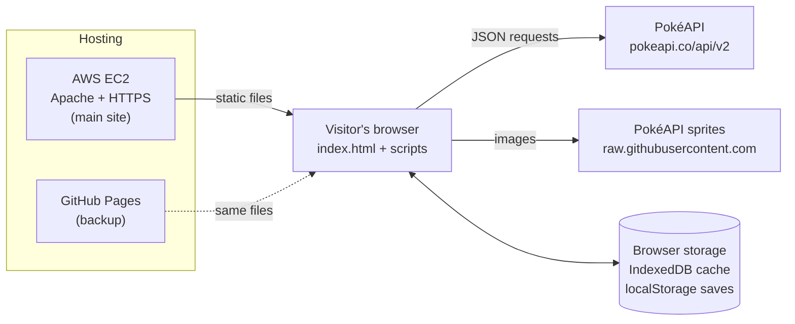
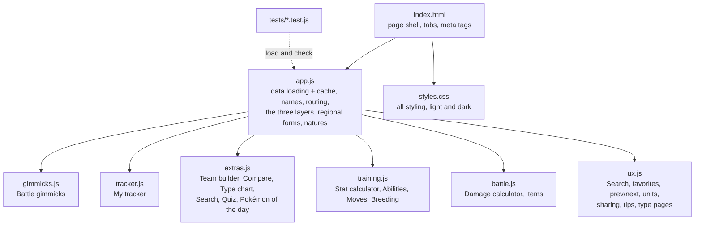
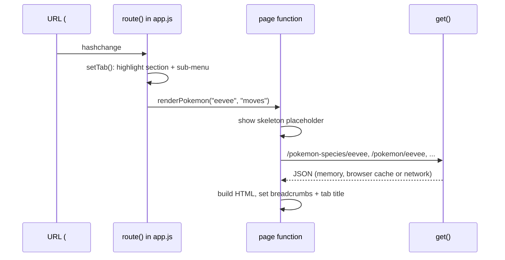

# Poké Explorer architecture

How the project is put together: the files, how a page gets from a URL to the screen, where data comes from, and where it's saved.

## Big picture

Poké Explorer is a **static single-page web app**. The server only hands out files (HTML, CSS, JavaScript, one image). Everything else happens in the visitor's browser, which talks to PokéAPI directly. There's no backend and no database.

## Files

The scripts are plain JavaScript loaded in order by `index.html` (no framework, no build step). They share one global scope, so later files use helpers defined in earlier ones (for example `get()`, `esc()` and `pokeName()` from `app.js`). The first page renders on `DOMContentLoaded`, after every script has loaded.

| File | Responsibility |
|---|---|
| `app.js` | `get()` and its caches, display-name helpers, the router and section navigation, theme switch, Regions → region list → Pokémon details, regional forms, natures |
| `gimmicks.js` | Mega Evolution, Primal Reversion, Z-Moves, Ultra Burst, Dynamax, Gigantamax and Terastallization, plus their reference tables (items, locations, Z-Move and Max Move names) |
| `tracker.js` | Games owned, caught/shiny Pokédex (list and PC boxes), forms, shiny hunts, export/import |
| `extras.js` | Team builder, team synergy score, auto-complete, Compare teams and team links, Compare, Type chart, Advanced search, Who's That Pokémon?, Pokémon of the day |
| `training.js` | Stat formula and calculator, IV/EV/nature guide, ability and move search, breeding, the Training & breeding panel |
| `battle.js` | Damage formula and calculator (abilities, items, Tera, field), Items browser |
| `ux.js` | Search index and dropdown (fuzzy matching), favorites and recently viewed, previous/next, metric/imperial units, share links and damage-link encoding, first-time tips, remembered sections, type pages, contrast checking |

## From a URL to a page

Every page has its own address after the `#`, so pages can be bookmarked, shared and reached with the Back button.

| Route | Page | Function |
|---|---|---|
| `#` | Home + region cards (Layer 1) | `renderRegions` |
| `#region/kanto` | Pokémon from a region (Layer 2) | `renderRegion` |
| `#pokemon/charizard[/tab]` | Pokémon details (Layer 3) | `renderPokemon` |
| `#forms`, `#forms/alola` | Regional forms | `renderRegionalForms` |
| `#gimmicks`, `#gimmicks/charizard` | Battle gimmicks | `renderGimmicks` |
| `#team`, `#team/a,b,c` | Team builder, shared team | `renderTeam` |
| `#teamvs/a,b,c/d,e,f` | Compare two teams | `renderTeamCompare` |
| `#damage`, `#damage/{settings}` | Damage calculator (settings shared in the link) | `renderDamage` |
| `#type/fire` | Type page: matchups and every Pokémon of that type | `renderTypePage` |
| `#natures`, `#natures/garchomp` | Natures | `renderNatures` |
| `#tools/{tool}[/…]` | Compare, Type chart, Search, Stats, Abilities, Moves, Items, Breeding, Quiz | `renderTools` |
| `#tracker/{tab}` | My games, Pokédex, Forms, Shiny hunts | `renderTracker` |

Page functions follow one pattern: set breadcrumbs, show a loading placeholder, `await` the data, then set `view.innerHTML` and attach event listeners. Any text from the API is passed through `esc()` before it goes into HTML.

## Data and caching

All PokéAPI requests go through `get(url)` in `app.js`:

1. **Memory:** the same request during one visit is shared, even if several parts of a page ask at once.
2. **Browser cache (IndexedDB):** responses are kept for 7 days, so repeat visits are fast and send fewer requests to PokéAPI.
3. **Network:** fetched from PokéAPI and saved to both caches. A 404 becomes a friendly "not found" message with "Did you mean…" suggestions.
4. **Offline fallback:** if PokéAPI can't be reached, an older saved copy is used even past 7 days; otherwise the page shows a **Try again** button.

Expensive data loads only when needed. For example, the Moves tab of a details page fetches move details the first time it's opened, and Advanced search shows results while the rest are still loading.

## What PokéAPI doesn't have

Some information isn't in PokéAPI, so it lives in clearly labelled tables in the code:

| Data | Where | Source |
|---|---|---|
| Shiny odds per game, with and without the Shiny Charm | `SHINY` in `app.js` | Standard published rates |
| Key-item and orb locations per game | `UNLOCK` in `gimmicks.js` | Bulbapedia |
| Mega Stone locations (X/Y, ORAS, Sun/Moon, USUM, Let's Go) | `STONE_LOC` in `gimmicks.js` | Gamer Guides, Prima Games, Pokémon GO Hub, Player.One, RPG Site |
| Z-Crystal locations | `Z_LOC` in `gimmicks.js` | Gamer Guides, Pokémon GO Hub |
| Z-Move, Max Move and G-Max Move names | `Z_TYPE`, `Z_EXCLUSIVE`, `MAX_MOVE`, `GMAX_MOVE` | Game data |
| Official spellings that can't be rebuilt from ids | `NAME_FIX`, `MOVE_FIX`, `ITEM_FIX` in `app.js` | Game data |
| Abilities the damage calculator models | `ATK_ABILITY`, `DEF_ABILITY` in `battle.js` | Game mechanics |

## What's saved in the browser

| Key (localStorage) | What it holds |
|---|---|
| `pokeExplorerTracker` | Games owned, caught and shiny Pokémon, caught and shiny forms, shiny hunts |
| `pokeExplorerTeam` | The six team builder slots |
| `pokeExplorerTheme` | Light or dark choice (absent means "match the device") |
| `pokeExplorerQuizBest` | Best quiz streak |
| `pokeExplorerFavorites` | Favorite Pokémon |
| `pokeExplorerRecent` | The 12 most recently viewed Pokémon |
| `pokeExplorerUnits` | Metric or imperial (absent means "based on the browser's language") |
| `pokeExplorerHints` | Tips the person has dismissed |
| `pokeExplorerLastPages` | The last page used in each main section |

Every read and write is wrapped in `try/catch`, and a corrupted or old-format save loads safely. **Export progress** writes the tracker data to a JSON file, and **Import progress** validates it before replacing anything.

## Search

`ux.js` builds one index from the species list (available immediately) plus forms, moves, abilities and items (loaded the first time someone focuses the search box). Names are normalized (lowercase, no accents or punctuation, so "Flabébé" matches "flabebe" and "Mr. Mime" matches "mr mime"). Matches are scored: exact name, then start of name, then start of any word, then contains, then typo tolerance using edit distance with swapped letters counted as one edit (1 typo for 4–6 letters, 2 for longer). Ties list Pokémon in Pokédex order. The dropdown follows the ARIA combobox pattern so it works with the keyboard and screen readers.

## Formulas

| Formula | Function | Checked against |
|---|---|---|
| Stats (Gen 3+): HP = ⌊(2B + IV + ⌊EV/4⌋)·L/100⌋ + L + 10; others = ⌊(⌊(2B + IV + ⌊EV/4⌋)·L/100⌋ + 5)·Nature⌋ | `calcStat` | Bulbapedia's level 78 Garchomp example |
| Damage (Gen 5+): ⌊⌊⌊2L/5 + 2⌋·Power·A/D⌋/50⌋ + 2, then spread, weather, crit, random 85–100%, STAB, type, burn, other modifiers | `damageRolls` | Bulbapedia's Glaceon vs Garchomp example (168–196) |
| Chance to KO in n hits (every combination of the 16 rolls) | `koChance` | Unit tests |
| Chance of a shiny within n encounters: 1 − (1 − 1/N)ⁿ | `chanceBy` | Unit tests |
| Team synergy (out of 100): defensive balance 30, offensive coverage 25, role mix 20, speed 15, type variety 10; minus 4 per empty slot; A ≥ 85, B ≥ 75, C ≥ 62, D ≥ 50 | `teamSynergy`, `bestSwaps`, `autoComplete`, `teamVersus` | Unit tests |

## Testing

`npm test` runs Node's built-in test runner on `tests/*.test.js` (no dependencies to install). `tests/load-site.js` loads the real site scripts into a sandbox with small stand-ins for browser APIs, so the tests check the same code visitors run. GitHub Actions (`.github/workflows/tests.yml`) runs the suite on Node 20 and 22 for every push and pull request.

## Styling

`styles.css` opens with a numbered table of contents. Every color is a token defined once in section 1; dark mode only redefines tokens, and `[data-theme]` lets the theme switch override the device setting. Part 2 of the file holds site-wide refinements (shared buttons, inputs, loading placeholders) and comes last on purpose, because it refines Part 1.

## Adding a new page

1. Write an `async function renderSomething(param)` that calls `setCrumbs(...)`, shows `loadingBlock()`, fetches with `get()`, then fills `view.innerHTML`.
2. Add a route for it in `route()` in `app.js`, and a sub-menu entry in `SECTIONS`.
3. If it's in a new file, add a `<script>` tag to `index.html` (a test checks that every `.js` file is loaded).
4. Add tests for any calculations in `tests/`.
